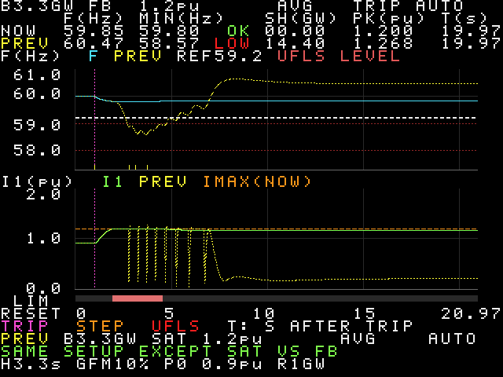
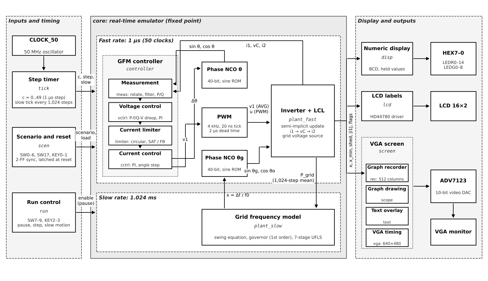
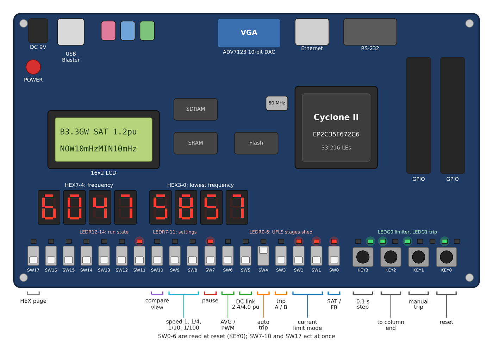
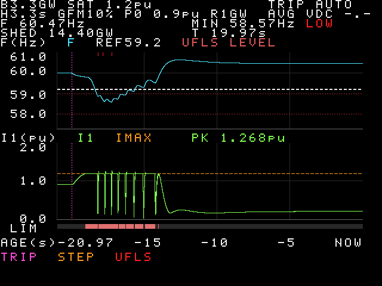
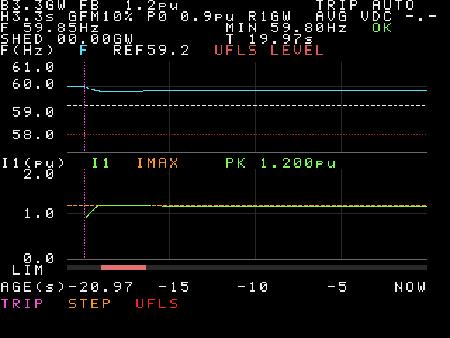
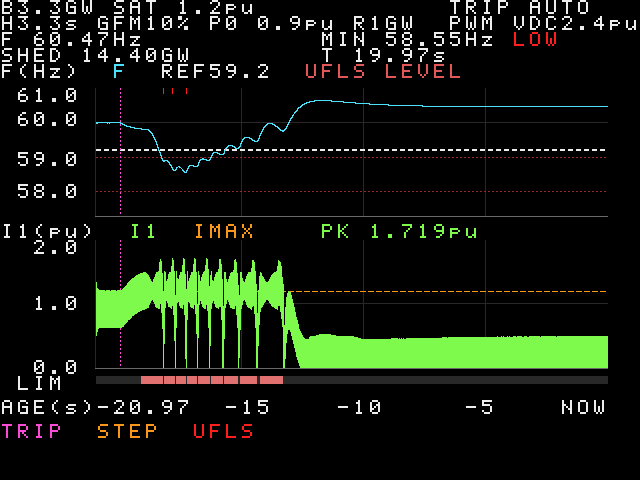
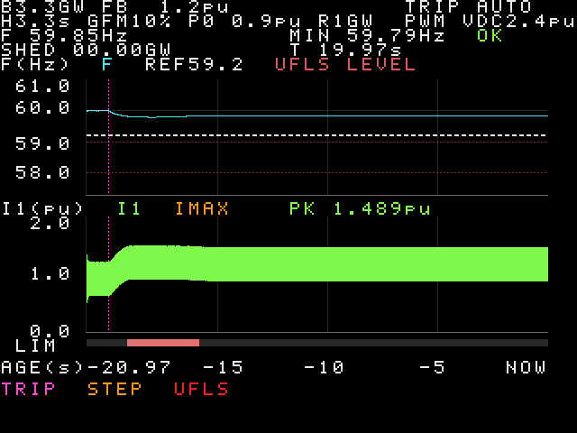
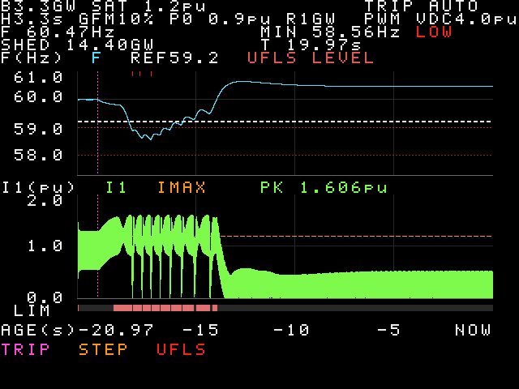
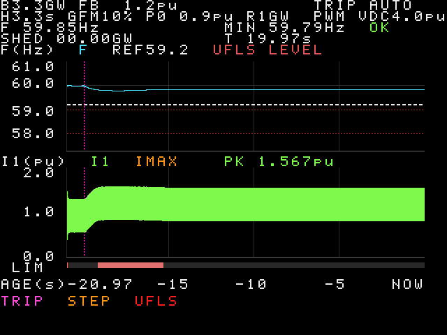
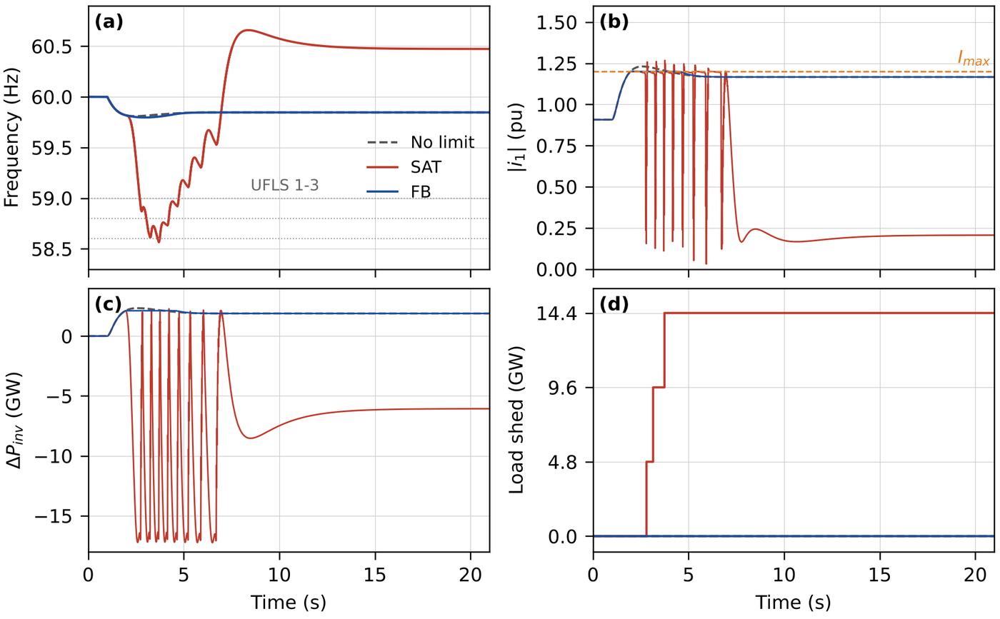

# FPGA Design Projects on the Altera DE2

This repo has our VHDL designs for the Altera DE2 board (Cyclone II EP2C35F672C6). We used Quartus II 13.0sp1 for synthesis and ModelSim-Altera for simulation. The whole design runs on the 50 MHz board clock, and slower timing is made with clock enables.

## Project 1: Counter and one-digit calculator

Both functions are in one bitstream. SW0 selects the counter or the calculator, and the board keeps working after the USB cable is removed.

### Counter

- KEY3, KEY2 and KEY1 add 1, add 2 and subtract 1. With SW1 on, the steps are 5, 10 and 5. KEY0 resets the count.
- The count wraps at both ends (9999 + 1 = 0, 0 - 1 = 9999). We chose this because a stop at 0 makes 3 - 5 + 5 give 5, not 3.
- LEDR13-0 show the count in binary. At 777, all 27 LEDs blink at 3 Hz.

### Calculator

- A and B come from SW17-14 and SW13-10. SW2-1 select +, -, x or /.
- An input over 9 shows `E`, and division by zero shows `Err`.
- Division shows the remainder too (`3 r1`). SW3 changes the result to hex.

| Item | Result |
|---|---|
| Source | 1 file, 71 lines |
| Logic elements | 1,876 |
| Registers | 50 |
| Pins | 100 |
| Board tests | 39 counter cases, 19 calculator cases |

Our first counter used `mod 10000` and only reached 43.4 MHz. Quartus built the modulo as a divider in the clocked path. After we changed it to a range check, Fmax went up to 113.0 MHz.

## Project 2: Real-time grid-forming inverter emulator

This part runs two models at different rates. A three-phase inverter model updates every 1 us, and a grid frequency model updates every 1.024 ms. We wanted to see how the current limit method of the inverter changes its frequency support to the grid. When a large generator trips, the grid frequency falls, and under-frequency load shedding (UFLS) cuts load in steps.

All arithmetic is fixed point. A Python model with the same integer rules made the test vectors, and the board gives the same numbers as this model.



*VGA comparison view after a SAT run and then an FB run. The screen images in this README are frames from an RTL simulation of the board's own display logic, fed with the reference model; the board shows the same values.*

### Structure



`core` holds the model. In each 1 us step, the controller (`meas`, `vctrl`, `limiter`, `cctrl`) reads the filter states and makes the converter voltage. The averaged model sends this voltage to the LCL filter directly, and the PWM model sends the mean phase voltage of the step instead. Every 1,024 steps, `plant_slow` takes the mean grid power and updates the grid frequency, UFLS and governor. `tick` sets the 50-clock step, and the blocks outside `core` handle the switches, the 7-segment and LCD display and the VGA screen.

| Part | Files | Lines | Without blank and comment lines |
|---|---|---|---|
| Model (`core` and below, with `gfm_pkg`) | 12 | 1,229 | 1,045 |
| Inputs and display (`board`, `scen`, `run`, `disp`, `lcd`, `screen`, `vga`, `rec`, `scope`, `text`) | 10 | 1,716 | 1,506 |
| Total | 22 | 2,945 | 2,551 |

The testbenches in `sim` are not counted here.

### Board inputs



| Input | Use |
|---|---|
| SW0 | Current limit method: `SAT` limits the current reference, `FB` also feeds the part of the reference over the limit back to the frequency loop |
| SW2-1 | Current limit: 1.2 pu, 1.2 pu then 1.0 pu after 10 s, or no limit |
| SW3, SW4 | Trip B (3.3 GW) or trip A (1.4 GW); manual trip with KEY1 or automatic trip at 1 s |
| SW6, SW5 | Averaged inverter or PWM inverter (4 kHz carrier, dead time) with a 2.4 or 4.0 pu DC link |
| SW7, KEY2, KEY3 | Pause; run to the end of the graph column; run 0.1 s |
| SW9-8 | Speed: 1, 1/4, 1/10 or 1/100 |
| SW10 | Compare this run with the previous one on the screen |
| SW17 | HEX page: lowest frequency, or shed load and time |
| KEY0 | Reset. SW0-6 are read only at reset |

The VGA screen (640x480) shows 21 s of frequency and inverter current, with marks for the trip, the UFLS steps and the current limit. The LCD shows the run settings.

### Results (trip B, 1.2 pu limit)

| Inverter model | SAT | FB |
|---|---|---|
| Averaged |  |  |
| PWM, DC link 2.4 pu |  |  |
| PWM, DC link 4.0 pu |  |  |

| Inverter model | Method | Lowest frequency | Load shed | Peak current |
|---|---|---|---|---|
| Averaged | SAT | 58.57 Hz | 14.40 GW | 1.268 pu |
| Averaged | FB | 59.80 Hz | 0 GW | 1.200 pu |
| PWM 2.4 pu | SAT | 58.55 Hz | 14.40 GW | 1.719 pu |
| PWM 2.4 pu | FB | 59.79 Hz | 0 GW | 1.489 pu |
| PWM 4.0 pu | SAT | 58.56 Hz | 14.40 GW | 1.606 pu |
| PWM 4.0 pu | FB | 59.79 Hz | 0 GW | 1.567 pu |

Only the current reference is limited, so the model current can still go over the limit. With `SAT` the inverter angle slips against the grid about eight times, and three UFLS stages of 4.8 GW each work in this case. With `FB`, the frequency stays above the first UFLS level, so no load is cut. The PWM model gives almost the same frequency, and its peak current is higher. The wide band in the PWM current graphs is the switching ripple inside each graph column.



| Item | Result |
|---|---|
| Source | 22 files, 2,945 lines |
| Logic elements | 16,900 (51 %) |
| Memory bits | 153,600 (32 %) |
| 9-bit multipliers | 55 of 70 |
| Setup slack at 50 MHz | 3.04 ns |
| Testbench checks | 310 in ModelSim |

One model step is 50 clocks. Each block of the model has a fixed clock slot in these 50 clocks, so the long multiply chains are split over several clocks and the whole design still closes timing at 50 MHz.

## Project 3: Project 2 split across two boards (planned)

This folder is only a skeleton for now. The plan is to run the controller on one DE2 and the inverter filter and grid on a second DE2. The target is a data exchange over the GPIO header every 1 us. We will start from the averaged model of Project 2 and check the split version bit for bit against a one-board model with the same delay.

## Layout

```
project_one/quartus_project1_counter_calculator_kk/   VHDL, pin and timing files
project_two/python/                                   reference model and vector scripts
project_two/src/, sim/, quartus/                      VHDL, testbenches and vectors, Quartus project
project_two/docs/                                     figures for this README
project_three/quartus/ctrl_board/, plant_board/       one Quartus project per board, no sources yet
```

## Building

Open the `.qpf` file in Quartus II 13.0sp1 and run a full compile. Keep unused pins set to "As input tri-stated". Program the board over JTAG with the RUN/PROG switch on RUN.

For Project 2, run `vsim -c -do run_tb.do` in `project_two/sim` to run all testbenches.

Project 3 has no source files yet, so its two Quartus projects do not compile.
